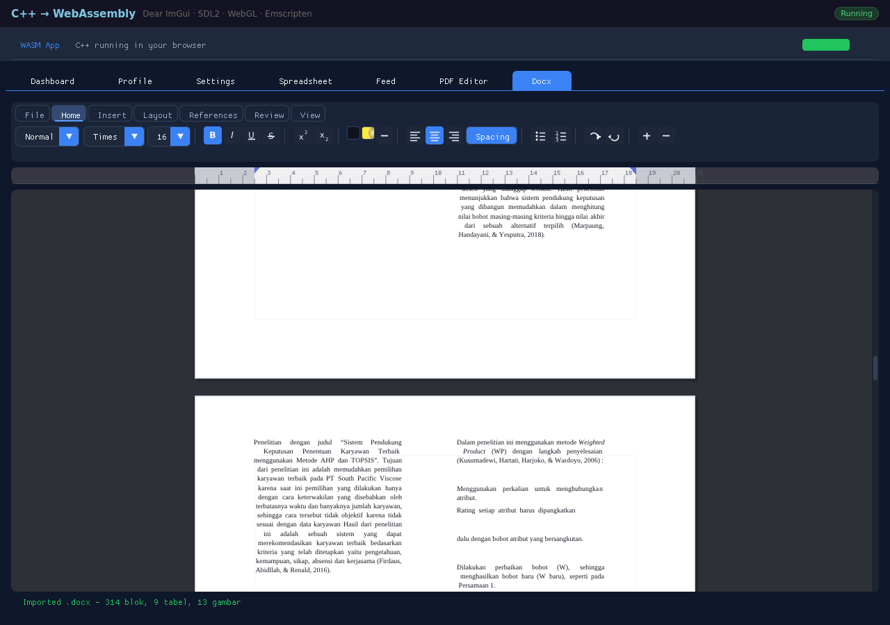
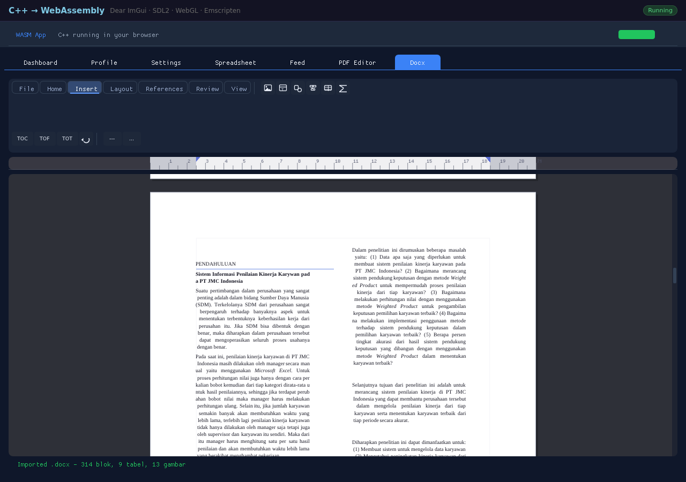
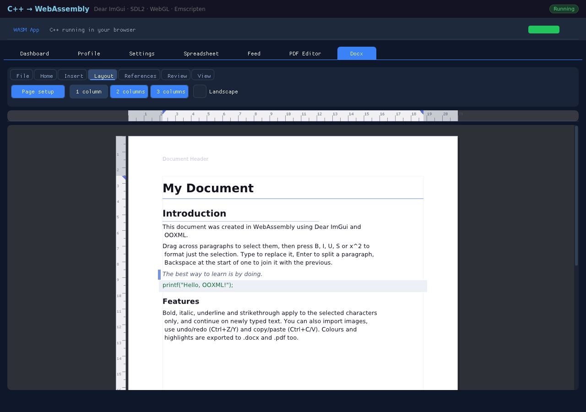
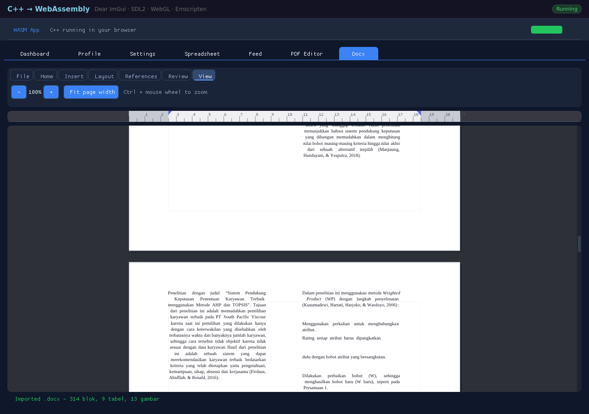

# wasm-ui — a document editor in WebAssembly

A word-processor style editor written in C++ with Dear ImGui and compiled to WebAssembly. It opens
and saves Word `.docx` (OOXML), exports PDF, and runs entirely inside the browser tab — no server,
no upload, nothing installed.

The screenshots below are a real Word document (a two-column academic paper, 314 paragraphs,
5 sections, 9 tables, 13 images) imported into the editor:



## Ribbon

Seven tabs, Office-style: **File** (page setup, open, export), **Home** (styles, font, size,
bold/italic/underline/strike, super/subscript, colour, highlight, alignment, spacing, lists,
undo/redo), **Insert** (image, header/footer, shapes, table, maths, diagrams, TOC/TOF/TOT),
**Layout** (page setup, 1/2/3 columns, landscape), **References** (indexes, rules),
**Review** (word/character count), **View** (zoom).

| Insert | Layout | View |
|---|---|---|
|  |  |  |

## What it does

- **Editing** — caret/selection across paragraphs, typing with undo/redo, find and replace,
  clipboard with formatting.
- **Character formatting** — bold, italic, underline, strike, super/subscript, colour, highlight,
  size, and eight embedded font families with real bold/italic faces (DejaVu plus
  Liberation/Carlito/Caladea as free metric-compatible replacements for Arial, Times New Roman,
  Courier New, Calibri and Cambria).
- **Paragraphs** — left/centre/right/justified, space before/after, line spacing, first-line and
  hanging indents, tab stops with leaders, lists, horizontal rules.
- **Tables** — insert and edit in place; column widths, per-side borders, cell shading and cell
  alignment imported from `w:tblGrid`/`w:tblPr`/`w:tcPr`.
- **Pages** — page size, orientation, margins, newspaper columns, header/footer text with page
  numbers, per-page setup, continuous and next-page section breaks.
- **Objects** — inline and floating images, shapes, LaTeX maths and Mermaid/Graphviz diagrams
  rendered to embedded images.
- **References** — table of contents, list of figures, list of tables, generated from headings and
  captions.
- **Files** — `.docx` import, `.docx` export, PDF export. Styles (`styles.xml`, `basedOn` chains,
  `docDefaults`), run fonts, section properties and table styling are read from the file rather
  than approximated.

### Typography against Word

Measured on the paper in the screenshots (Word and LibreOffice both paginate it to 10 pages):

| | Word / LibreOffice | wasm-ui |
|---|---|---|
| body face and size | Times New Roman 12 pt | Liberation Serif 12 pt (metric-compatible) |
| line pitch | 14.45 pt | 14.4 pt |
| first page content | 3314 characters | 3317 characters |
| pages | 10 | 9 |
| PDF export | — | strict-parse clean, 0 overlapping glyphs |

The remaining page-count difference is table and figure pagination, not type metrics.

## Known limitations

OOXML support is partial and measured, not assumed: footnotes/endnotes, comments, tracked changes,
fields, numbering definitions and table merges are not imported yet, and the `.docx` writer emits
direct formatting rather than named styles. The full audit, per-part matrices and the roadmap are in
[docs/OOXML-COMPATIBILITY.md](docs/OOXML-COMPATIBILITY.md) and [docs/PLAN.md](docs/PLAN.md).

Silent data loss is the honest risk: a document with footnotes or tracked changes opens with those
parts dropped. Treat it as an editor for straightforward documents, not as a Word replacement.

## How it compares

| | wasm-ui | Collabora Online | ZetaOffice (LibreOffice in wasm) |
|---|---|---|---|
| engine | own model, layout and OOXML reader (~2 MB wasm) | LibreOffice, native, server-side | LibreOffice, compiled to wasm |
| document location | stays in the tab | uploaded, rendered on the server | stays in the tab |
| OOXML fidelity | partial (measured above) | LibreOffice's | LibreOffice's |
| collaboration | none | real-time multi-user | none |
| footprint | 2 MB, no backend | container stack, CPU per session | ~250 MB runtime |

## Security

The parser is wasm: a malformed `.docx` can corrupt the module's own linear memory but cannot read
files, exec a process or escape the browser sandbox. Nothing is uploaded, and macros, OLE objects and
external relationships are never executed — they are dropped. Caveats: the demo server (`main.py`)
has no authentication, a hostile file can still exhaust memory (denial of service), and unsupported
features are dropped rather than rejected.

## Build

Requirements: [emsdk](https://emscripten.org/docs/getting_started/downloads.html) on `PATH`
(`. ~/emsdk/emsdk_env.sh`), and Dear ImGui cloned next to `main.cpp`:

```bash
git clone --depth 1 https://github.com/ocornut/imgui imgui
./build.sh          # produces index.html, index.js, index.wasm, index.data
```

`fonts_data.h` is generated from the embedded TTFs by `tools/fonts/build_fonts.py`; it is committed
so the build works without the font sources.

## Run

```bash
python3 -m venv .venv && ./.venv/bin/pip install flask
./.venv/bin/python main.py        # http://127.0.0.1:5555/
```

Any static file server works too; `main.py` just disables caching so rebuilds show up.

## Repository layout

```
main.cpp                 UI, document model, layout, PDF writer, OOXML import/export
doctext.hpp              line layout, hit-testing, justified text, selection rects
pdf_widths.h             standard-14 font metrics used by the PDF writer
fonts_data.h             embedded subset TTFs + font family table
shell.html               the JS shell (file pickers, image/maths decode, exports)
build.sh                 emscripten build
main.py                  tiny Flask host
duckx/                   patched duckx (OOXML writer) + pugixml + miniz
tools/fonts/             font subsetter / header generator
tools/ooxml-corpus/      one .docx fixture per OOXML feature area
tools/ooxml-check/       headless import/export probes, strict PDF + overlap checks
docs/                    roadmap and OOXML compatibility audit
```

## Tests

`tools/ooxml-check` drives the real wasm module in headless Chromium: it imports every corpus
fixture, dumps the model, exports `.docx`/`.pdf`, and asserts strict-PDF structure (no repair
tolerance) plus zero overlapping glyphs. See [tools/ooxml-check/README.md](tools/ooxml-check/README.md).

## Licences

Application code: MIT (see `LICENSE`). Dear ImGui: MIT. duckx, pugixml, miniz: MIT.
DejaVu fonts: Bitstream Vera licence. Liberation, Carlito, Caladea: SIL Open Font Licence.
